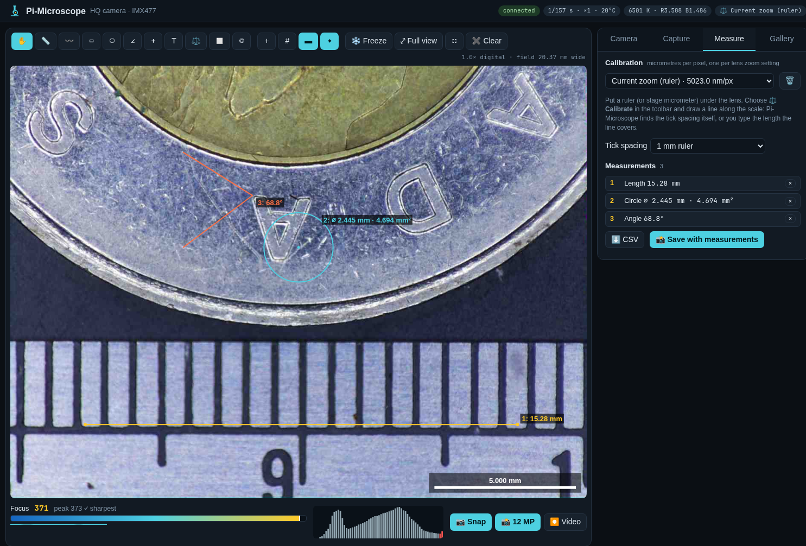
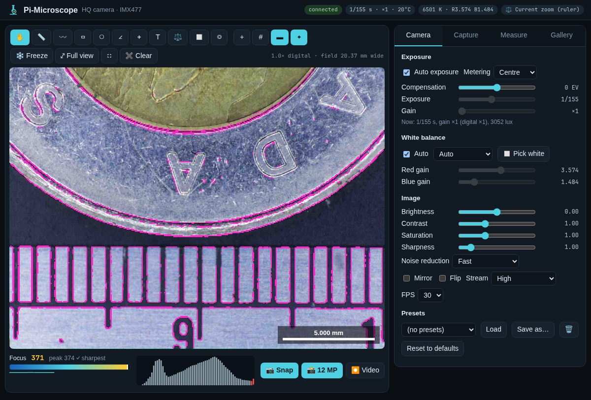
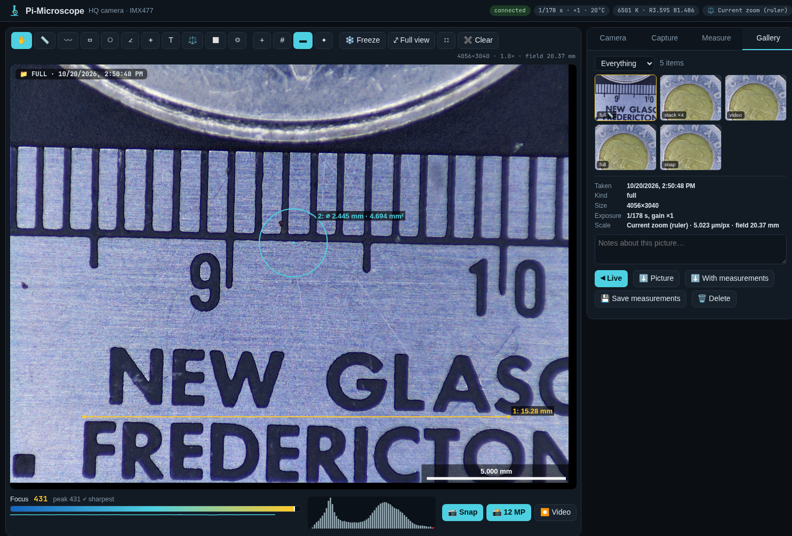

# Pi-Microscope

A web microscope for a **Raspberry Pi HQ Camera** (Sony IMX477, 12 MP) on a microscope: open it in any browser on
the network and get a fast live view, proper camera controls, calibrated measurements, focus stacking, video,
time-lapse and a gallery. Built for a C-mount zoom inspection microscope with a ring light on a Pi 4.

## What it does

- **Live view** at ~25 fps of the sensor's **whole field of view** (2×2 binned mode), hardware MJPEG, low latency.
  **Digital zoom on the sensor** (wheel to zoom, drag to pan, double-click to zoom in): the zoom crops the sensor, so
  zooming in shows real detail instead of enlarged pixels.
- **Camera controls**: auto or manual exposure (1/10 000 s to 2 s) and gain, exposure compensation and metering,
  auto or manual white balance with presets, **click-to-white-balance** (drag over something white or grey), brightness,
  contrast, saturation, sharpness, noise reduction, mirror / flip, stream quality and frame rate. **Presets** save a
  whole setup ("PCB, ring light", "coins"...).
- **Focus assist**: a live focus meter (sharpness in an area you choose, with peak hold, "✓ sharpest" and a 15 s trace)
  and **focus peaking** (the sharp edges light up).
- **Measuring**: length, path, rectangle (width, height, area), circle (diameter, area), angle, count, labels.
  Measurements are stored in sensor coordinates, so they stay on the specimen while you zoom; the list exports to CSV.
- **Calibration** per lens zoom setting, in micrometres per sensor pixel (so it holds at any digital zoom and any
  capture size). Put a ruler or stage micrometer under the lens and draw a line along it: Pi-Microscope **finds the
  tick spacing itself** (FFT of the brightness along the line, sub-pixel) or you type the length. Grid and **scale bar**
  overlays use it.
- **Captures**: 📷 2 MP snap (instant, no interruption), 📸 full 12 MP (4056×3040, live view pauses ~3 s), optional
  **raw DNG**, and **Save with measurements** (12 MP plus an annotated copy with the measurements and a scale bar).
- **Focus stacking**: press Start, turn the focus knob through the subject, press Fuse. Frames are kept only when the
  focus has moved; they're aligned (OpenCV ECC, affine, for focus breathing) and fused with soft per-pixel sharpness
  weights into one all-in-focus picture, plus a depth map.
- **Video** (H.264 MP4, 1352×1014) recorded alongside the live view, and **time-lapse** (2 MP or 12 MP frames every N
  seconds, made into an MP4 at the end).
- **Gallery**: thumbnails, open any picture in the viewer to zoom and measure it (with its own calibration), notes,
  downloads (original, with measurements, DNG, depth map), delete.

## How it's built

- `server.py`: Python, **picamera2** (libcamera) for the camera, **aiohttp** for HTTP, the MJPEG stream and the
  WebSocket. Three streams: main 2028×1520 (captures, stacking, white balance), lores 1352×1014 (hardware MJPEG
  preview and H.264 video), raw. 12 MP stills switch mode for one frame. A stats thread sends exposure, white
  balance, the focus metric (variance of the Laplacian in the focus area) and a histogram five times a second.
- `stack.py`: focus stacking (ECC alignment, Laplacian-energy weighted fusion, depth map).
- `web/`: the browser app (plain JS, no build step). Focus peaking runs in the browser on the displayed frames.
- Data in `data/`: `images/` (pictures, videos, DNGs, JSON metadata), `thumbs/`, `settings.json`,
  `calibrations.json`, `presets.json`.

## Install (Raspberry Pi OS / Debian trixie, Pi 4)

1. `sudo apt install python3-picamera2 python3-opencv python3-aiohttp python3-av python3-numpy` (most come with
   Raspberry Pi OS).
2. Copy this folder to the Pi (e.g. `~/pi-microscope`) and run `python3 server.py`, or with pm2:
   `pm2 start ecosystem.config.js && pm2 save`.
3. Open `http://<pi>:8075/`.

Only one program can use the camera: stop any other camera app first (here: `sudo systemctl disable --now raspiCamSrv`).

`./deploy.sh` copies it to `root@192.168.2.94:/home/jim/pi-microscope` and restarts it. Settings: `PORT` (8075),
`DATA_DIR` (`./data`).

## API

`/stream.mjpg` (`?fps=5` to throttle), `/snapshot.jpg`, `/api/status`, `/api/images`, `/images/<file>`,
`/thumbs/<id>.jpg`; everything else over the WebSocket at `/ws` (`set`, `wb`, `capture`, `autocal`, `stackStart`,
`stackFinish`, `videoStart`, `tlStart`, `calSave`, `imgUpdate`, ...).

MIT licence.
